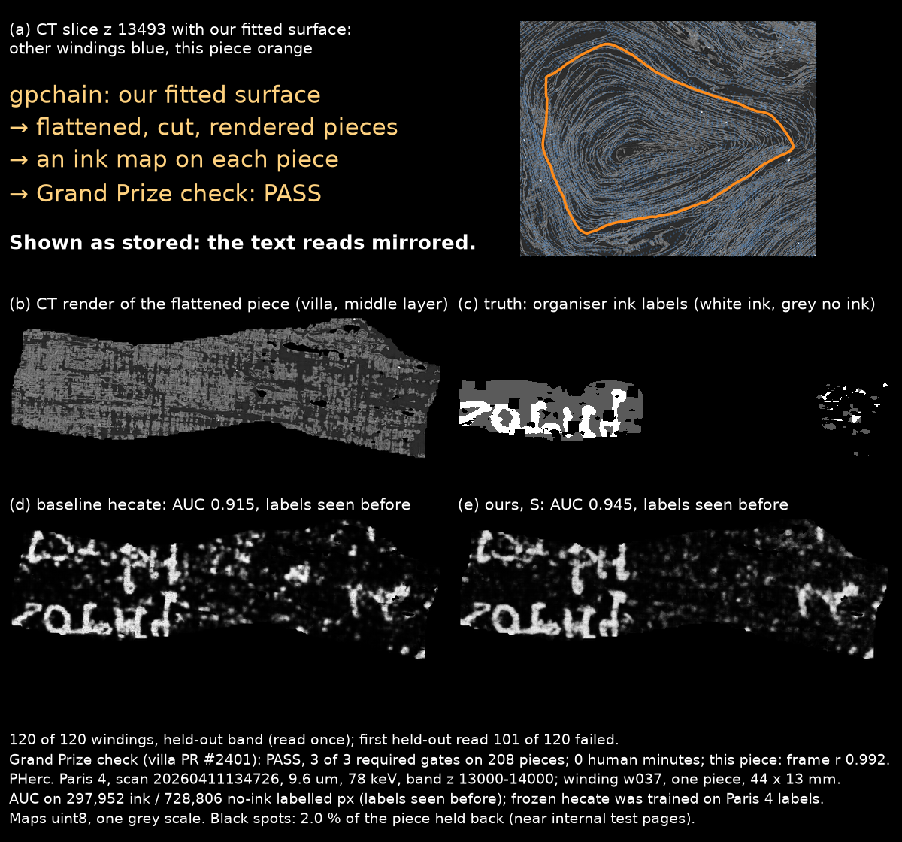

# vesuvius-gpchain: from a fitted scroll surface to a folder that passes the Grand Prize format check of villa #2401

gpchain takes the per-winding meshes of a fitted scroll surface and makes, with **0 human minutes**, the folder that
the format check of villa pull request #2401 (`vesuvius.gp_submission check`; a draft pull request by phippsrtyler,
closed by its author on 2026-11-24, not merged; not in villa, not an organiser tool) accepts: flattened mesh pieces
(`column_NN.tifxyz`, which VC3D opens unchanged), a 16-layer CT render of each piece, an ink map per piece, and a
record of every stage (inputs, outputs, sha256, decisions, human minutes).

- **In:** one winding of a fitted surface (villa tifxyz, CT voxel coordinates), the CT (OME-Zarr), the scroll's
  umbilicus (and, optional, organiser segment meshes as a layer-order reference), an ink checkpoint.
- **Out:** per winding `OUT/wNNN/` (pieces, renders, maps, `chain.json`); across windings, one submission folder and
  the check's report.
- **Tested on:** PHerc. Paris 4 at 9.6 µm only, from our own spiral fit. Paris 4 is **not** a Grand Prize 2027
  volume; this is a rehearsal of the chain, not an entry.



## Numbers

Each number has its baseline, its data and a results file in `results/`.

| number | baseline | data | kind | file |
|---|---|---|---|---|
| **120 of 120** windings covered (every piece passes the frame check, gets a layer order and an ink map) | the same band with the first frame-check rule: 113 of 120; the **first held-out read failed, 101 of 120** (bar 108) on another band | Paris 4, fit T-B-s2, z 13000-14000, 208 pieces | held-out (read once) | `f626_heldout_band_z13000-14000.json` (`C_COV3`, `held_out_reading`); `f623_fail_first_heldout_read_z12000-13000.json` (`C_COV3`) |
| format check of villa #2401 **PASS**, 3 of 3 required gates, on the 208-piece folder; **0 human minutes** | the prize allows at most 8 hours of human input | same band | held-out | `f626_…json` (`P1`, `ledger`) |
| layer order: S ink AUC **0.930** in the order the chain picks, **0.560** in the flipped order | the flipped order | same band, 2 pieces with organiser ink labels (514 654 ink, 1 197 774 no-ink px) | held-out band; the labels had been read by other work | `f626_…json` (`C_ORD`) |
| repeat from a fresh clone, in our Docker image: **6 of 6** windings byte-equal (11 pieces, 13 ink maps), 0.39 GPU-h | the comparator flags 6 of 6 swapped winding pairs | 6 windings of the same band | repeat | `f637_fresh_clone_repeat_6_windings.json` |

On its dev band (z 11000-12000, another fit) the same chain covered 117 of 120
(`f610_dev_band_z11000-12000.json`).

## What you need on your machine

| item | need |
|---|---|
| OS | x86-64 Linux |
| villa VC3D tools | `vc_tifxyz2obj`, `flatboi`, `vc_obj2tifxyz` from villa `6bbe6e21` and `vc_render_tifxyz` from villa `47111d1a`. `scripts/build_villa.sh` builds them from source with Docker (build only; ≈ 1 h of CPU, needs network); or build them yourself and lay them out as that script does |
| Python | `uv` 0.11.16; `scripts/make_venvs.sh` makes two environments from the hash-locked lists in `env/` (6.1 GB: `w2401` 0.8 GB for the chain and the check, `gpu` 5 GB for the ink maps) |
| GPU | the ink maps only: one CUDA card, driver with CUDA 13 (torch cu130); 2.1 GB VRAM peak measured, book 10 GB. 27-130 s per piece |
| RAM | 16 GB (15.8 GiB peak for six windings incl. maps) |
| CPU | 8 threads |
| disk | villa tools 1 GB (+ the Docker build cache); CT 8.49 GB (4390 chunks) for the three example windings (`f644_…json`, `B_IN.ct`), more for the whole band; outputs 20-220 MB per winding, 21 GB for the band |
| network | the public bucket (CT, segment meshes), GitHub (villa), PyPI, Hugging Face |

**Tested this way:** the shortest path below was run on one host (villa built from source, chain on the host, no
image of ours) for w011, w108 and w129: same per-piece decisions as the stored held-out run, meshes, renders, CT cuts
and ink maps byte-equal on 7 of 7 pieces, the format check of villa #2401 passed (`f644_outside_path_check_3_windings.json`). Not
yet tried on another machine.

No Docker image of ours is needed. At run time nothing runs in a container: the chain calls villa as
`docker run IMAGE …`, and `scripts/docker-shim.py` (put on `PATH` as `docker` by `run_winding.sh`) runs the tool
built in `VCB` instead.

## Shortest path (the Paris 4 example, three windings)

```bash
bash scripts/build_villa.sh vcb                          # villa tools from source (Docker for the build only)
bash scripts/make_venvs.sh venvs                         # hash-locked Python environments
venvs/w2401/bin/python scripts/get_inputs.py in --windings w011 w108 w129 \
    --fit-from FIT_DIR --ckpt-from S.pth                 # every input, sha256-checked (inputs/manifest.json)
venvs/w2401/bin/python scripts/fetch_ct.py ct in/fit/w011_spliced in/fit/w108_spliced in/fit/w129_spliced
for w in w011 w108 w129; do
  bash scripts/run_winding.sh --fit in/fit/${w}_spliced --out out/$w --ct ct --inputs in --venvs venvs --vcb vcb
done
venvs/w2401/bin/python scripts/make_folder.py sub out/w011 out/w108 out/w129     # folder + the format check of villa #2401
venvs/w2401/bin/python scripts/coverage.py out/w011 out/w108 out/w129            # the coverage rule
```

`S.pth`: the file `hecate_onsheet_S.pth` from https://huggingface.co/jo-tud/hecate-onsheet; `FIT_DIR`: the fit meshes (see "Hosting"). For your own
fit, skip `get_inputs.py`: give `run_winding.sh` your winding mesh, your CT root (group `0` = the mesh's voxel frame),
and an `--inputs` folder with `umbilicus.json`, `models/hecate.py`, `models/S.pth` and `segments/` (may be empty;
then the layer order comes from the umbilicus alone).

**Outside-path check** (this tree, run as above from a fresh clone, villa built from source, no image of ours):
see "Tested this way" above; every number is in `results/f644_outside_path_check_3_windings.json`.

## Stages (per winding, `tools/gpchain/chain.py`)

1. **Isometric stage**: the winding mesh is flattened (villa `vc_tifxyz2obj` → `flatboi` → `vc_obj2tifxyz`).
2. **Band cuts**: the flat mesh is cut into pieces of at most 300 grid cells (57.6 mm at 9.6 µm; `band_cuts.py`).
3. **CT cut** (`--ct-cut --ct-cut-px`): quads whose render pixels would all be empty CT are removed (`ct_cut.py`).
4. **Render**: villa `vc_render_tifxyz`, 16 layers along each piece's normal (`render_contract.py`).
5. **Layer order**: the piece normal is compared with nearby organiser segment meshes (`--segments`), else with the
   umbilicus (`--umbilicus`), so the ink model reads the layers in the right direction.
6. **Frame check**: the render must match the CT sampled at the piece positions (Pearson r ≥ 0.95). Empty pixels may
   lie only in the piece's edge band, which villa leaves unrendered: half a node cell (`render_config.json`
   `frame.rim_limit = "edge_band"`).
7. **Ink map** (`render_contract.py infer`): a hecate-architecture 2D ink model on the ordered layers, one uint8 map
   per piece. A piece that fails the frame check or has no layer order gets no map; the reason is written down.
8. **Folder and check** (`scripts/make_folder.py`): pieces + maps → `meshes/column_NN.tifxyz`,
   `images/column_NN.tif` → `vesuvius.gp_submission check`.

`chain.json` holds every stage's inputs, outputs and sha256, the route taken, the layer order with its reason, the
frame-check numbers, the CT-cut counts and the **human-input ledger** (`human_inputs`, `human_minutes`).
`tools/gpchain/package.py` is our fuller package step (banner, scale bar, false-positive form); it is included as
used, but its `--orient measure` needs code that is not in this tree.

## Wall time (one machine: 8 CPU threads, one RTX PRO 6000)

| step | time |
|---|---|
| villa tools from source (`build_villa.sh --jobs 8 --no-cache`, cold) | 30 min (25 min `6bbe6e21`, 5 min `47111d1a`) |
| CT fetch from the public bucket | 8.49 GB in 17 min for the three example windings (`f644_…json`, `B_IN.ct.fetch_s`) |
| `chain.py` (stage → frame check) | 8-35 s per winding (1-3 pieces) |
| ink map | 27-130 s of GPU per piece |
| 120-winding band (208 pieces) | 8.8 GPU-h for the maps; the CPU stages ≈ 1 h |

## Known limits and named fails

- **Paris 4 only, one resolution, our own fit.** Not tested on another scroll, another scan or another fit method.
  Paris 4 is not eligible for the 2027 Grand Prize.
- **The first held-out read failed** (101 of 120, bar 108): a fixed limit on empty render pixels did not fit villa's
  unrendered edge band. The rule was changed once (limit sized by each piece's own edge band) and read once on a new
  band: 120 of 120. That is one band of one scroll after one change.
- **Columns are not papyrus columns.** Pieces are cut at a fixed length. Our automatic column-edge finder failed its
  unseen test and was stopped after 4 attempts (`f622_fail_column_finder.json`), so the chain makes no column cuts.
- **No reading orientation.** Pieces and maps are stored as villa lays them out; text can read mirrored (see the
  figure). Our orientation rule is not confirmed on a second scroll and is not part of the tested path.
- **Legibility is not tested.** The chain makes ink maps; whether letters can be read on them is a separate question.
- **The fit is an input.** It was made with villa `spiral-fitting` (`6bbe6e21`, no human winding input); the fit
  runs are not part of this tree.
- **villa pins.** Two VC3D commits and the head of a closed, unmerged pull request (`VILLA.md`). Newer villa is not tested; the edge-band frame
  check depends on villa's half-cell no-data rim.
- **The format check is not villa's.** `vesuvius.gp_submission` is code from a closed, unmerged community pull
  request: villa #2401, a draft by phippsrtyler, closed by its author on 2026-11-24; not in villa, not an organiser
  tool. `scripts/make_venvs.sh` fetches its head commit `ea48ce6b` by hash; GitHub may stop serving it. A pass means
  the folder meets that pull request's gates, nothing more.
- **Float drift in one intermediate.** flatboi's OBJ texture coordinates differ between runs by ≤ about 1e-11 of
  their size; the meshes, renders and maps made from them were byte-equal in the tested windings.
- **One GPU model** for byte-equal maps (the card of the stored run).

## Hosting

- Code: this repository, https://github.com/jo-tud/vesuvius-gpchain (2.5 MB; 0.8 MB of it the figure, 0.9 MB result
  files).
- S checkpoint (523 MB, CC BY-NC 4.0): https://huggingface.co/jo-tud/hecate-onsheet. `get_inputs.py` checks its
  sha256 (`4b84fdf2f90cb369b254f04415d474bac8ab087a47022badd2d20fa32205b4f2`).
- Fit meshes of the example (120 tifxyz folders, 32 MB; CC BY-NC 4.0): release asset of this repository,
  https://github.com/jo-tud/vesuvius-gpchain/releases/download/v0.1/gpchain-fit-T-B-s2-z13000-14000.tar.gz
  (18.8 MB, sha256 `95506fb01ca7bd265f29828ca31dfb6a612db53556a9fe802bbf261fe9d63e85`). Unpack it and give the folder as `FIT_DIR`; `get_inputs.py` checks every file against
  `inputs/manifest.json`.

## Licence

Code: MIT (`LICENSE`). Inputs, villa and models keep their own licences: `THIRD_PARTY.md`, `VILLA.md`.
Where each file came from: `PROVENANCE.md`.
